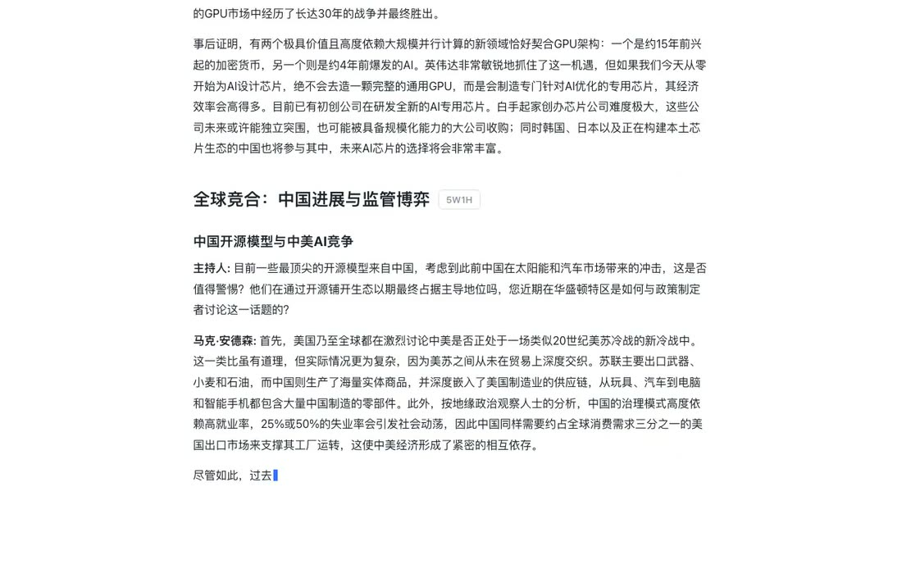
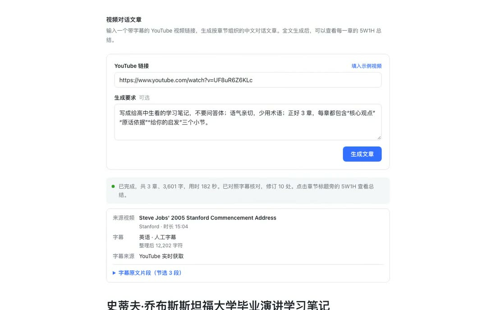
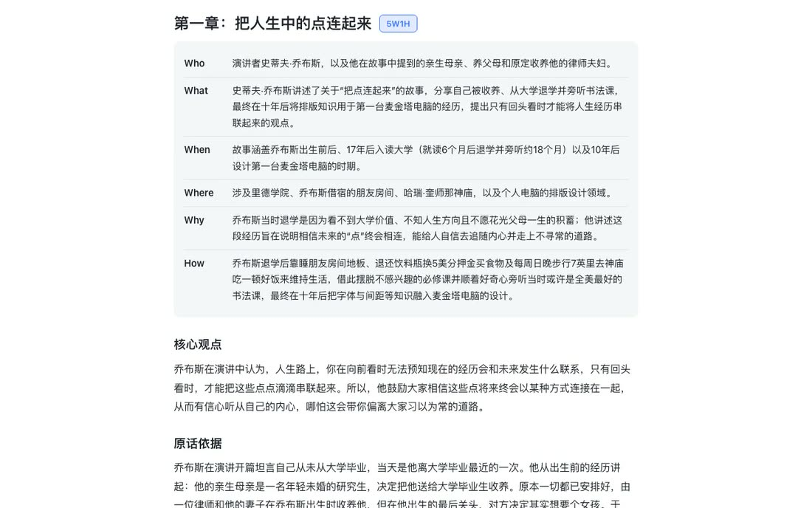

# 视频对话文章（video-article）

输入一个带字幕的 YouTube 视频链接，生成按章节组织的中文文章：

- 正文由 Gemini 流式生成，边生成边在页面上显示；
- 全文保存后，每一章都可以查看 5W1H 总结；
- 可以选填一段自然语言要求，调整任务类型、风格、受众和约束条件。

- **在线地址**：https://video-article.kingsleyli920.workers.dev
- **技术栈**：TypeScript、Cloudflare Workers、Durable Object（SQLite）、原生前端、marked + DOMPurify，前端用 esbuild 构建。

## 演示

线上应用真实运行的录屏，录在版本 `ed446a6c` 上（之后的版本只调整了核对修订的合并逻辑，页面和流式没有变），字幕都是从 YouTube 实时取到的。画面只有应用页面，没有模拟打字，没有回放预先生成的文章。纯等待的片段做了加速，画面顶部的黄色横幅写明了倍速和实际耗时；输入、正文出现和增长、最终结果、核对记录、5W1H 和手机宽度都是原速。

| | 内容 | 实际耗时 |
|---|---|---|
| [默认生成（2 分 16 秒）](docs/demo/demo-default.mp4) | 示例视频，不填要求：来源面板 → 正文流式出现 → 核对 → 保存 → 核对记录 → 通读 → 第 2 章 5W1H → 手机宽度 | 63 秒出第一段正文，279 秒保存完成；6 章，11,295 字 |
| [自定义要求（1 分 46 秒）](docs/demo/demo-requirements.mp4) | 乔布斯斯坦福演讲，要求"给高中生看的学习笔记，不要问答体，正好 3 章，每章三个指定小节"：输入要求 → 生成 → 结果满足要求 → 第 1 章 5W1H → 手机宽度 | 59 秒出第一段正文，183 秒保存完成；3 章，3,601 字 |

正文边生成边显示：



填写要求后的结果，状态条下方是来源信息，标题下方有"生成要求核对"一行：



章节标题旁的 5W1H：



录屏时遇到的问题和每段的细节记在 [最终验收记录](docs/FINAL_ACCEPTANCE.md) 第零节第 10 小节。

## 快速开始

需要 Node.js 22 或以上。

```bash
npm install
cp .env.example .env      # 本地运行只需要填 GEMINI_API_KEY
npm run dev               # 打开 http://127.0.0.1:8787，点"填入示例视频"即可体验
```

环境变量、部署步骤和账户核对见 [实现说明](docs/IMPLEMENTATION.md) 文末。

## 实现说明

下面五项对应题目要求的说明，每项只写做法和取舍；细节、实测数据和代码位置在 [docs/IMPLEMENTATION.md](docs/IMPLEMENTATION.md)。

### 1. 如何获取和处理 YouTube 字幕

- **获取**：Worker 直接请求 YouTube 的 InnerTube 接口拿字幕轨道，优先人工字幕，其次自动字幕。
- **被拦截时**：先在同一出口换客户端身份重试；仍被人机验证拦下时，把请求交给部署在其他区域的 Durable Object 代取。实测直连被拦的请求，换区域后都取到了。题目建议的代理没有采用：它需要额外的账号，而换区域已经够用。
- **示例视频的备份**：仓库里存了一份示例视频的真实字幕。只有示例视频、且实时获取全部失败时才用它，页面会写明用的是备份。
- **处理**：按时间合并成段落并保留时间戳，交给模型的是整理后的全文。字幕里明显残缺的数字会被遮蔽，避免模型把它补成一个确定的数。

### 2. 如何调用 Gemini 并实现流式输出

- Worker 调用 Gemini 的流式接口，把模型的输出逐块转成 SSE 事件发给浏览器，浏览器边收边渲染成 HTML（marked 解析，DOMPurify 清洗）。没有攒够再发，也没有模拟打字。
- 等待模型思考期间，服务端定时发心跳，页面显示等待状态和字幕来源。
- 上游、下游写入、浏览器空闲各有超时；浏览器断开后服务端中止上游请求，不再保存。
- 主模型繁忙且还没有输出时换备用模型；已经输出了一部分就不换，避免拼接两个模型的文字。
- 刷新页面：最近一篇完成的文章存在浏览器本地，刷新后恢复，5W1H 照常可用。生成中刷新会断开连接、这次生成作废，所以浏览器会先确认；刷新后页面把链接和要求填回去并说明上次被中断。

### 3. 如何根据用户生成要求影响输出结果

- 用户的要求原样放进提示词的独立区块，说明它可以调整任务类型、风格、受众和约束，但不能越过结构和忠实度的底线（比如要求编造内容）。
- 字数、章数、每章小节这类能数出来的约束，不只靠提示词：另发一个小请求把约束提取出来，每一项都要能在用户原话里找到出处；文章写完后由程序按统一口径核对。
- 不满足时在原稿基础上修订一次再核对；仍不满足就明确报错、不保存，不把不合要求的文章显示成成功。

### 4. 如何实现章节级 5W1H 总结

- 文章生成并核对完成后，服务端把字幕、最终文章和章节目录存进这次生成对应的 Durable Object。
- 点击章节标题旁的 5W1H 时，浏览器只发生成编号和章节编号，不带正文。服务端取出保存的上下文，把整段字幕、章节目录和当前章节交给模型。
- 模型按 JSON schema 返回六个字段，服务端校验后返回，页面用固定的表格渲染。字幕里没有依据的字段显示"原文未明确提及"。同一章的结果会缓存。

### 5. 写完之后的核对

题目没有要求这一步，是为内容准确加的。只靠提示词，文章里仍会出现年份安错对象、主持人的话写成嘉宾说的、数字的确定程度被改掉这类错误。

- 文章流式写完后、保存前，按章对照字幕核对，另加一次整篇复核和一次只查不确定语气的核对，几路并行。
- 模型只负责指出问题并给出改法；每条修订都要带字幕原文作依据。程序核对依据确实在字幕里、位置唯一、不破坏结构，才替换那一句，其余文字不动。
- 两条修订改到同一处时，只有结果完全一致才算重复；否则再请模型基于当前文章确认。指出了问题却落实不了的，这次生成失败、不保存。
- 页面标题下方列出每一处修订的原句、改法和字幕依据。

## 测试

```bash
npm run typecheck
npm run test:fast          # 全部 vitest 层：后端单测、Worker 集成、后端 E2E、前端单测、前端功能
npm run test:all           # 再加上不调用真实模型的 Playwright 项目（需先 npx playwright install chromium）
```

- 测试按依赖从少到多分层，失败、超时、重试和备用切换都在受控的模拟上游里测，不调用真实模型。分层和命令见 [实现说明](docs/IMPLEMENTATION.md) 文末。
- 逐条对应题目要求的验收结论和每个缺陷的原因、修复、证据：[docs/REQUIREMENTS_ACCEPTANCE.md](docs/REQUIREMENTS_ACCEPTANCE.md)。
- 最终版本上的真实模型验收和演示录屏：[docs/FINAL_ACCEPTANCE.md](docs/FINAL_ACCEPTANCE.md)。
- 各轮的过程记录（测试矩阵、模型评估、补充验收、失败记录）保留在 [docs/history/](docs/history/)。

## 主要工程取舍

- **模型负责找问题，程序负责把关**：修订必须带字幕原文、能确定位置才采用；用户约束由模型提取、程序核对出处和数值。程序检查的是证据和可计算的约束，不等于证明内容全对。
- **准确优先于速度**：核对让整篇多等两到三分钟，期间正文已经可以阅读，但 5W1H 要等保存后才可用。
- **不引入额外的存储服务**：一次生成对应一个 Durable Object，生命周期和清理都简单；代价是没有列表和检索，这个题目用不上。
- **按 marked 的词法 token 识别章节**：不用正则切分，代码块里的 `##` 不会被误认成章节；前后端共用同一份解析和字数口径。
- **不用前端框架**：页面只有一个表单、一篇文章和若干面板，原生 TypeScript 加 esbuild 就够了。
- **凭据和部署隔离**：部署脚本先核对账户再执行；本地变量按白名单生成；有检查确认前端产物和 Worker 打包产物里没有凭据。

## 实际限制

- **Gemini 用的是付费档**：题目写的是免费 API。线上用 `gemini-4-hydrogen` 加高档思考，账户是预付费，余额用完时生成会失败并明确提示。免费层下的表现没有复测。
- **等待和费用**：第一段正文实测在一分钟左右出现（最近两次录屏是 59 秒和 63 秒），整篇三到五分钟；每篇估算 0.6 到 1.4 美元。
- **核对不是每次都能查出每一处**：核对本身是模型做的，同一类问题有时查出、有时漏掉。程序保证的是每处改动有字幕依据、不改坏结构。
- **字幕恢复**：换区域在实测里救回了被拦的请求，但那是有限的样本；各区域同时被拦时，除示例视频外仍会失败。
- **备用模型**：线上没有真实触发过，只在受控故障测试里验证。
- **约束提取**：模型把写了数字的要求整个漏掉时，程序分辨不出来。
- **生成中刷新不能接着生成**：连接断开后服务端就停止了，只能重新生成。

## 目录结构

```
src/
  client/    页面、流式消费、文章渲染、来源面板、5W1H 面板
  shared/    章节解析和字数、SSE、类型、错误文案、大小上限
  worker/    路由、生成流程、Gemini、YouTube、提示词、核对与修订、Durable Object
scripts/     部署核对、构建、探针
test/        后端单测、Worker 集成、后端 E2E、前端单测与功能、浏览器用例
docs/        实现说明、需求验收对照、最终验收记录、演示；history/ 是过程记录
```
